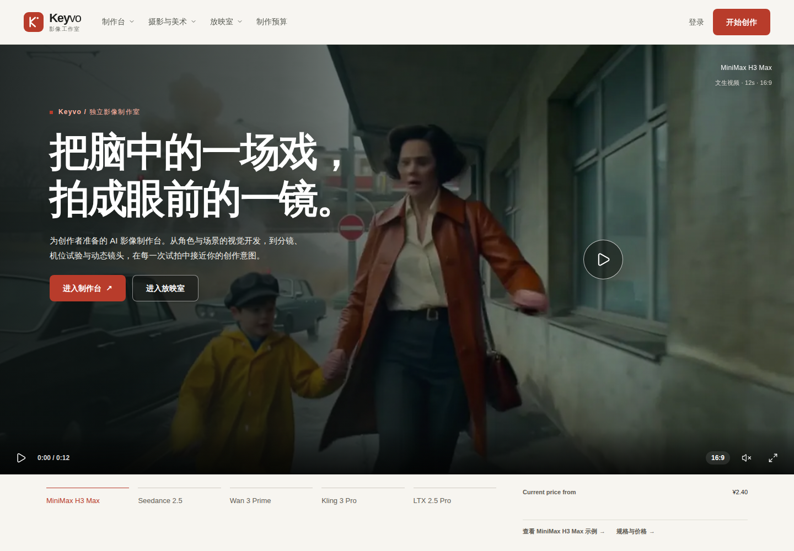
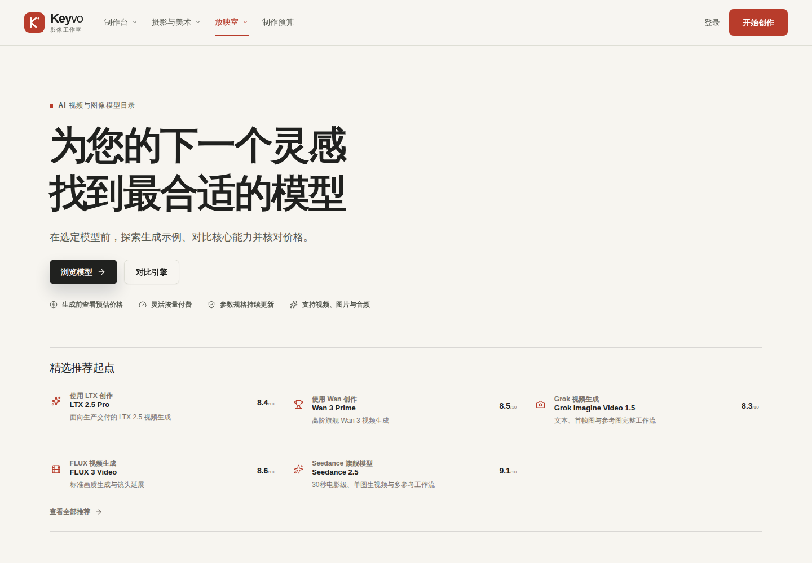
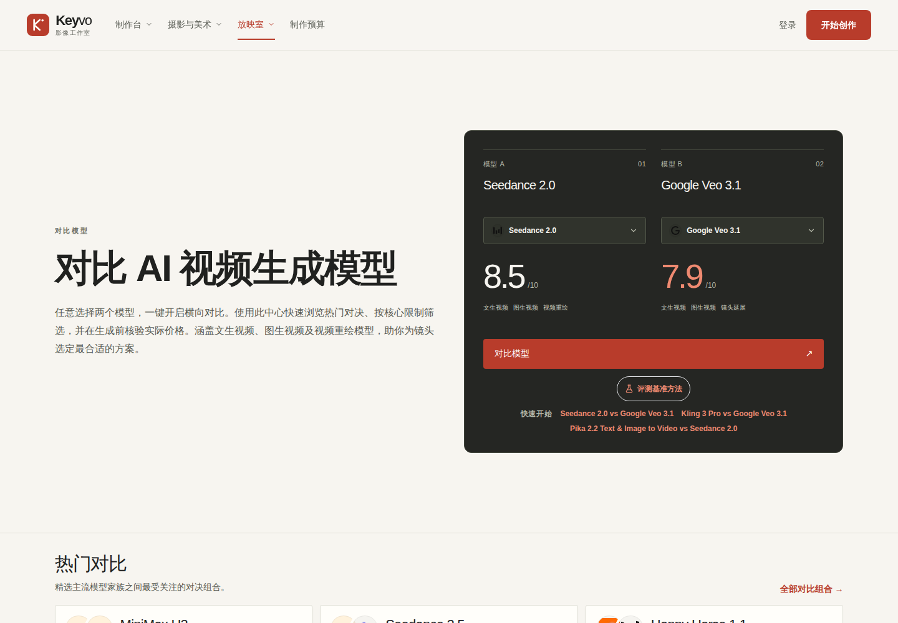
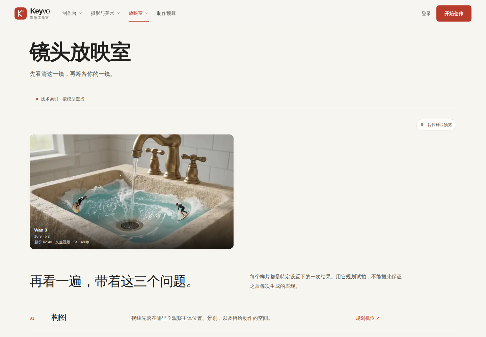
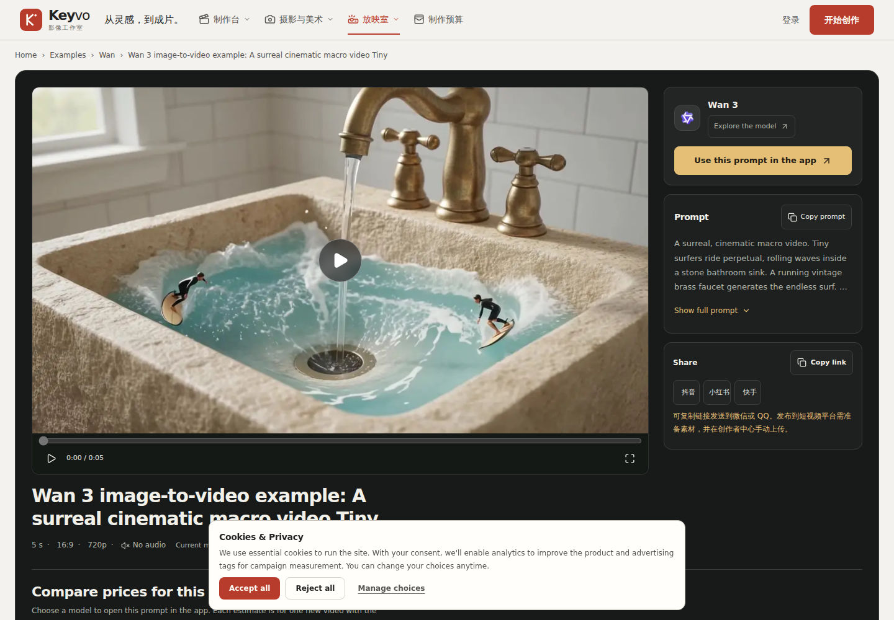
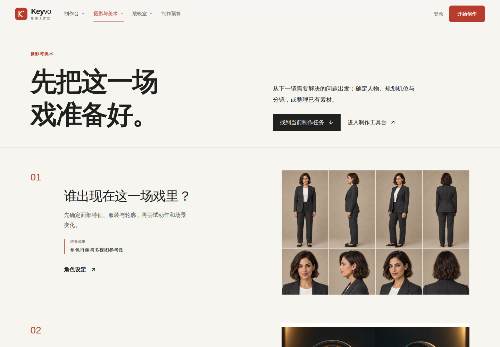

# Keyvo

**比较模型、查看价格，在同一个工作台创作。**

Keyvo 是基于 MaxVideoAI 定制的 AI 视频与图像创作平台。本仓库包含模型目录、生成工作台、私有作品库、人民币账户充值及后台管理。

[打开 Keyvo](https://app.keyvo.cn) · [查看模型](https://app.keyvo.cn/zh/models) · [查看定价](https://app.keyvo.cn/zh/pricing)



## 选择模型与工作流

模型目录和比较页展示当前站点的模型信息。截图记录页面展示，不代表每个供应商、每种模式均完成真实付费验收。





## 查看价格与充值

本次定价页截图采集记录到一次 React hydration 错误；该页面暂缓作为已通过运行检查的发布证明。

选择模型、参数和参考素材后，在提交前核对当次报价。Keyvo 的客户钱包以人民币计价；账户充值采用站点配置的支付渠道。供应商成本与客户钱包收费分别核算。

[查看定价页](https://app.keyvo.cn/zh/pricing)（截图暂缓发布）

## 案例与工具

案例页现已展示一项经授权的 Wan 3 图生视频：参考图 Sink_Surfers.png，5 秒、720p，当次钱包收费 ¥4.80。真实生成与公开播放已验收；这不代表所有模型与模式均已验收。





工具入口用于寻找适合的准备或处理流程；具体能力、参数和价格以当前站点及提交前报价为准。

[查看案例页](https://app.keyvo.cn/zh/examples) · [播放已验收的 Wan 3 视频](https://app.keyvo.cn/video/job_4a7156e8-2b3e-4569-9a34-b0ec5485cc8e)



## 工程与部署

| 目录 | 职责 |
| --- | --- |
| `frontend/` | Next.js 页面、API、生成与计费业务 |
| `neon/migrations/` | PostgreSQL 应用迁移 |
| `docker/` | 应用与迁移镜像构建 |
| `tests/` | 契约、数据库及浏览器验证 |
| `plugins/maxvideoai/` | 保留的上游插件源码与兼容标识 |

应用镜像和迁移镜像分别运行。部署应使用 GitHub 已发布的完整提交标签，检查迁移结果及 Quality CI，再执行运行环境验收。

```bash
pnpm install
cp frontend/.env.local.example frontend/.env.local
pnpm dev
```

环境操作详见 [本地开发](docs/engineering/local-development.md) 与 [环境变量](docs/engineering/environment-reference.md)。

开发前阅读根目录 `AGENTS.md` 和 `docs/engineering/llm-working-guide.md`。

## 来源与许可证

| 项目 | 说明 |
| --- | --- |
| 原始项目 | [MaxVideoAI](https://github.com/camgraphe/MaxVideoAi) |
| 定制仓库 | [Keyvo / VideoAi-Agent](https://github.com/wans10/VideoAi-Agent) |
| 许可证与署名 | 原仓库 `LICENSE`、`NOTICE` 及 `docs/licensing/` 继续适用 |
| 插件发布 | 上游发布记录不自动证明 Keyvo 的主机连接与安装路径 |

截图采自 `app.keyvo.cn` 的公开页面；采集记录、源版本说明及 SHA-256 摘要见 [采集记录](docs/marketing/keyvo-review/capture-evidence.json)。
